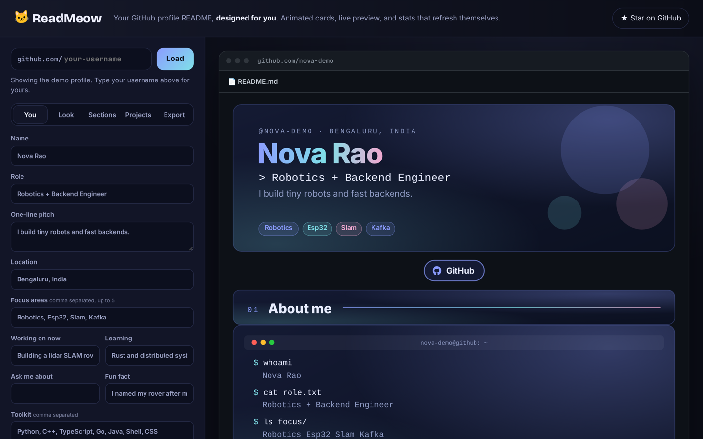
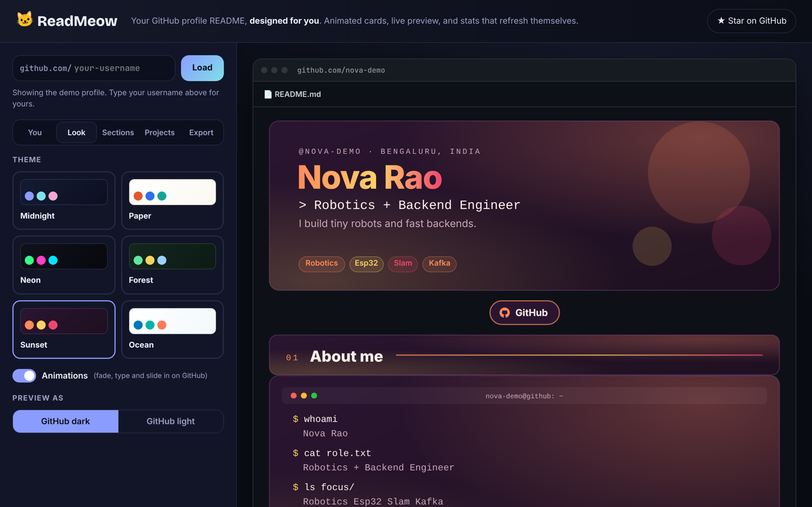

<h1 align="center">🐱 ReadMeow</h1>
<p align="center"><b>Your GitHub profile README, designed for you.</b><br>Type a username, pick a theme, download. Animated cards, and stats that refresh themselves every day.</p>

<p align="center"></p>

## Why another README generator?

Most generators stitch together images from third-party stats services. Those get rate-limited, go down, and all look the same. ReadMeow is different:

- **Your cards live in your repo.** Every card is a self-contained, animated SVG saved in `assets/readmeow/`. No outside image service can break your profile.
- **Stats that update themselves.** The download includes a tiny GitHub Action that redraws your stats, languages and project cards once a day, using only GitHub's own token. It never touches your `README.md`, so your edits are safe.
- **Designed, not assembled.** Six themes (Midnight, Paper, Neon, Forest, Sunset, Ocean) where every card shares one look, with animations that respect *reduced motion*.
- **Accessible.** Every card has a real title and description, so screen readers read your profile properly.
- **Private.** Everything runs in your browser. No sign-up, no server, no tracking.

## What you get

| Card | What it shows |
|---|---|
| Header | Your name, role with a blinking cursor, your pitch, focus areas |
| Links | GitHub, LinkedIn, portfolio, X, email, résumé, as matching badges |
| About me | A terminal that types out `whoami`, what you're working on, learning, a fun fact |
| GitHub stats | Repos, stars, followers, years on GitHub (auto-refreshed) |
| Top languages | Measured by bytes of code across your top repos (auto-refreshed) |
| Projects | Up to 6 repos you pick, with language, stars and topics (auto-refreshed) |
| Toolkit | Your skills as colour chips |
| Footer | A sign-off line over animated waves |

Drag to reorder any section, or hide it.

<p align="center"></p>

## Use it

1. Open ReadMeow, type your GitHub username and press **Load** (or try the demo profile).
2. Edit your details, pick a theme, choose projects and sections.
3. **Export → Download ZIP**.
4. Create a repository named exactly like your username (for example `octocat/octocat`). GitHub shows its README on your profile.
5. Upload everything from the ZIP, keeping the folders (`assets/`, `.readmeow/`, `.github/`).

That's it. The **ReadMeow refresh** workflow runs daily; you can also run it from your repo's **Actions** tab.

## Run it locally

```bash
git clone https://github.com/HemashreeVI/ReadMeow.git
cd ReadMeow
python3 -m http.server 8000
```

Then open http://localhost:8000. (A local server is needed so the export can bundle the refresh script.)

## How it works

```
index.html, css/app.css     the studio
js/cards.js                 card engine: pure functions, data → animated SVG (runs in the browser and in Node)
js/readme.js                builds README.md + every card file from your settings
js/zip.js                   tiny dependency-free ZIP writer for the export
js/demo.js                  a fictional demo profile, works offline
action/refresh.js           runs in your profile repo: re-fetches GitHub data, redraws the cards
action/readmeow.yml         the daily GitHub Actions workflow
```

The same `cards.js` draws the preview in the studio and the cards in the Action, so what you see is exactly what you get.

## Tech

HTML, CSS and vanilla JavaScript. GitHub REST API. No frameworks, no build step, no dependencies.

## Author

**Hemashree V. I.** · [@HemashreeVI](https://github.com/HemashreeVI)

## License

MIT
